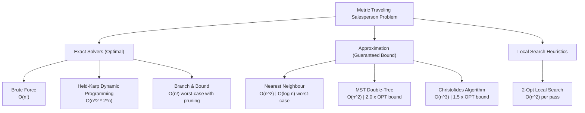
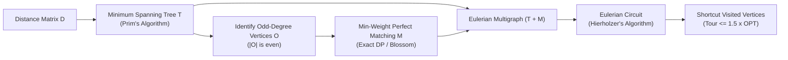

# Metric Traveling Salesperson Problem (TSP): Exact, Approximation, and Heuristic Algorithms

[](https://www.python.org/)
[](tests/test_tsp.py)

A comparative algorithmic study evaluating exact exponential solvers, provable polynomial-time approximation algorithms, and local search heuristics for the **Metric Traveling Salesperson Problem (TSP)** on 2D Euclidean instances.

---

## 1. Problem Overview

The **Traveling Salesperson Problem (TSP)** asks for the shortest closed route that visits every city exactly once and returns to the starting point.

In **Metric TSP**, distances satisfy the **triangle inequality**: the direct path between two cities is never longer than taking a detour through a third city:

$$\text{distance}(A, B) \le \text{distance}(A, C) + \text{distance}(C, B)$$

Because straight-line Euclidean distances on a 2D plane naturally satisfy this property, skipping already-visited intermediate cities (shortcutting) will never increase the total tour length.

---

## 2. Algorithm Taxonomy & Complexity



| Algorithm | Type | Time Complexity | Space Complexity | Guarantee ($\text{Tour} / \text{OPT}$) | Practical Limit |
|---|---|---|---|---|---|
| **Brute Force** | Exact | $O((n-1)!)$ | $O(n)$ | Optimal ($1.0\times$) | $n \le 10$ |
| **Held-Karp** | Exact (DP) | $O(n^2 \cdot 2^n)$ | $O(n \cdot 2^n)$ | Optimal ($1.0\times$) | $n \le 18$ |
| **Branch & Bound** | Exact (Pruning) | $O((n-1)!)$ | $O(n)$ | Optimal ($1.0\times$) | $n \le 13$ |
| **Nearest Neighbour** | Greedy | $O(n^2)$ | $O(n)$ | None ($O(\log n)$ worst-case) | $n \ge 10^4$ |
| **MST Double-Tree** | Approximation | $O(n^2)$ | $O(n)$ | $\le 2.0\times \text{OPT}$ | $n \ge 10^4$ |
| **Christofides** | Approximation | $O(n^3)$ | $O(n^2)$ | $\le 1.5\times \text{OPT}$ | $n \le 2 \times 10^3$ |
| **2-Opt** | Local Search | $O(n^2)$ per pass | $O(n)$ | None (Empirical $\approx 1.00 - 1.05\times$) | $n \le 10^3$ |

---

## 3. Algorithm Descriptions

### 3.1 Exact Algorithms (`tsp/exact.py`)
* **Brute Force:** Evaluates every possible permutation of cities $(n-1)!$ with city 0 fixed as the starting point to identify the global minimum.
* **Held-Karp Dynamic Programming:** Uses bitmask dynamic programming over subsets of visited cities. It computes and stores the shortest path visiting a subset and ending at city $j$, avoiding redundant recomputation of subpaths.
* **Branch and Bound:** Explores partial tours via depth-first search while visiting closer cities first. At each step, it calculates a lower bound based on the minimum outgoing edges of unvisited cities; any branch whose lower bound meets or exceeds the best-known tour is immediately pruned.

### 3.2 Approximation & Heuristic Algorithms (`tsp/approx.py`)
* **Nearest Neighbour:** Greedily travels to the closest unvisited city at each step and connects back to the start at the end. Very fast, but can leave a long closing edge.
* **MST Double-Tree (2-Approximation):** Computes a Minimum Spanning Tree (MST) using Prim's algorithm, doubles the tree edges to form an Eulerian graph, traverses it in preorder, and shortcuts repeated cities. By the triangle inequality, the resulting tour length is at most twice the optimal tour ($2.0\times \text{OPT}$).
* **Christofides (1.5-Approximation):** Improves on the MST method by finding a minimum-weight perfect matching only among the vertices with odd degrees in the MST. Combining the MST with this matching produces an Eulerian graph with fewer excess edges, guaranteeing a tour length at most $1.5\times \text{OPT}$.
* **2-Opt Local Search:** Starts with an existing tour (e.g., from Nearest Neighbour) and repeatedly checks pairs of edges. If swapping two edges eliminates an intersection and reduces overall tour length, the intermediate segment is reversed until no further improvement is possible.

#### Christofides Pipeline



---

## 4. Empirical Evaluation

### 4.1 Exact Algorithm Runtimes & Node Expansion ($n \in [4, 18]$)

| $n$ | Brute Force (s) | Branch & Bound (s) | B&B Nodes Expanded | Held-Karp DP (s) | Total Tours $(n-1)!$ |
|---:|:---:|:---:|:---:|:---:|:---:|
| **4** | $< 0.001$ | $< 0.001$ | 10 | $< 0.001$ | 6 |
| **6** | $< 0.001$ | $< 0.001$ | 69 | $< 0.001$ | 120 |
| **8** | 0.0057 | 0.0015 | 687 | 0.0010 | 5,040 |
| **10** | 0.5030 | 0.0082 | 2,630 | 0.0050 | 362,880 |
| **12** | *Timeout* | 0.1159 | 31,522 | 0.0267 | $3.99 \times 10^7$ |
| **13** | *Timeout* | 0.4753 | 125,624 | 0.0574 | $4.79 \times 10^8$ |
| **16** | *Timeout* | *Exceeded* | — | 0.5584 | $1.31 \times 10^{12}$ |
| **18** | *Timeout* | *Exceeded* | — | 2.4989 | $3.56 \times 10^{14}$ |


---

### 4.2 Approximation Ratio Comparison ($n=12$, 40 Random Instances)

Performance evaluated against the exact optimal tour from Held-Karp ($\text{Ratio} = \frac{\text{Tour Length}}{\text{Optimal Length}}$):

| Algorithm | Mean Ratio | Median Ratio | Worst-Case | Best-Case | Theoretical Bound | Guarantee Met |
|---|:---:|:---:|:---:|:---:|:---:|:---:|
| **Nearest Neighbour** | 1.112 | 1.101 | 1.366 | 1.000 | $O(\log n)$ | Yes |
| **MST 2-Approx** | 1.185 | 1.169 | 1.408 | 1.000 | $\le 2.0\times$ | **Passed ($\le 2.0$)** |
| **Christofides** | 1.056 | 1.045 | 1.139 | 1.000 | $\le 1.5\times$ | **Passed ($\le 1.5$)** |
| **NN + 2-Opt** | 1.003 | 1.000 | 1.053 | 1.000 | None (Heuristic) | Near-optimal |


---

### 4.3 Large-Scale Performance ($n \in [20, 150]$ vs. MST Lower Bound)

For larger instances where exact methods are intractable, tour quality is compared against the MST weight lower bound ($\text{Quality} = \frac{\text{Tour Length}}{\text{MST Weight}}$):

| $n$ | Metric | Nearest Neighbour | MST 2-Approx | Christofides | NN + 2-Opt |
|---:|---|:---:|:---:|:---:|:---:|
| **20** | Quality Ratio <br> Time | 1.509 <br> $< 0.1$ ms | 1.627 <br> $0.1$ ms | 1.412 <br> $0.3$ ms | **1.289** <br> $0.3$ ms |
| **50** | Quality Ratio <br> Time | 1.433 <br> $0.2$ ms | 1.558 <br> $0.4$ ms | 1.258 <br> $65.4$ ms | **1.233** <br> $2.8$ ms |
| **100** | Quality Ratio <br> Time | 1.416 <br> $0.9$ ms | 1.538 <br> $1.4$ ms | 1.269 <br> $35.6$ ms | **1.222** <br> $12.1$ ms |
| **150** | Quality Ratio <br> Time | 1.436 <br> $1.8$ ms | 1.531 <br> $2.8$ ms | 1.252 <br> $105.4$ ms | **1.202** <br> $30.7$ ms |


---

### 4.4 Tour Visualizations

Tour topologies produced across all algorithms on an identical 14-city Euclidean instance:


---

## 5. Repository Structure

```
├── tsp/
│   ├── __init__.py           # Package exports
│   ├── exact.py              # Brute force, Held-Karp DP, Branch & Bound
│   ├── approx.py             # Nearest Neighbour, Prim MST, Double-tree, Christofides, 2-Opt
│   └── utils.py              # Instance generator, Euclidean distance, tour verification
├── tests/
│   └── test_tsp.py           # 16 pytest unit tests (exact agreement, theoretical bounds)
├── outputs/
│   ├── exact_runtime.csv     # Benchmark runtimes and node counts
│   ├── approx_ratio.csv      # Ratio distributions across 40 instances
│   └── figures/              # Benchmark plots and pipeline diagrams
├── main.py                   # Single-instance CLI demonstration
├── benchmark.py              # Complete benchmark suite and figure generation
└── requirements.txt          # Python dependencies
```

---

## 6. Setup & Usage

### 6.1 Installation
```bash
git clone https://github.com/AdityaWagh19/TSP-Solver.git
cd TSP-Solver
pip install -r requirements.txt
```

### 6.2 Run Single Demo
Compare all algorithms on a random Euclidean instance of size $n$ with random seed $s$:
```bash
python main.py <n_cities> <random_seed>
# Example:
python main.py 10 7
```

### 6.3 Run Benchmark Suite
Run all experiments and regenerate CSV results and publication figures in `outputs/`:
```bash
python benchmark.py
```

### 6.4 Run Tests
Execute the test suite verifying algorithm correctness and approximation guarantees:
```bash
python -m pytest -v
```
