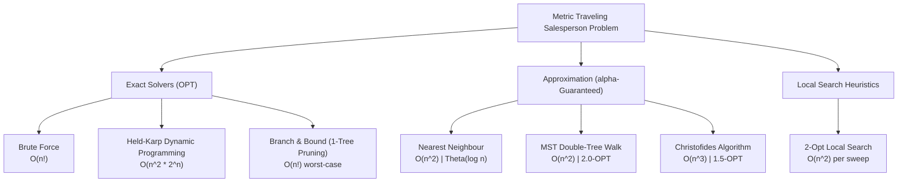
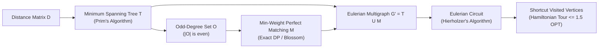
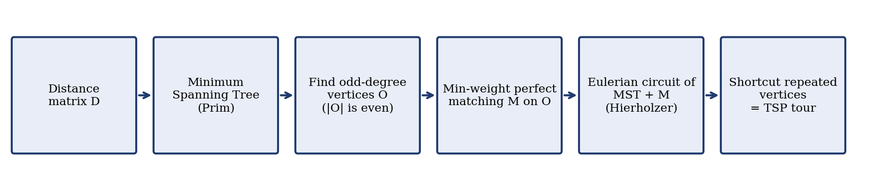
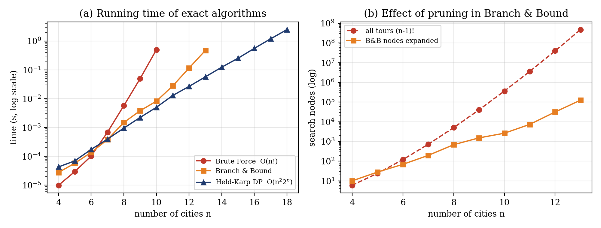
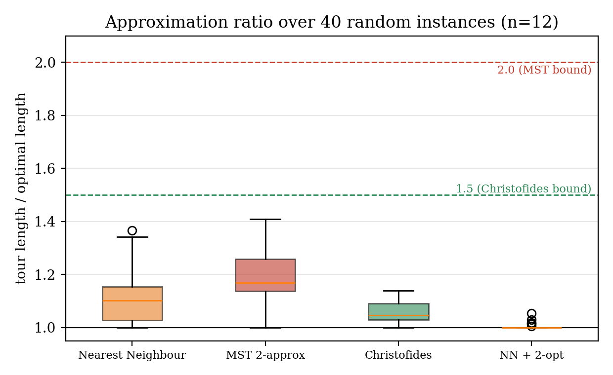
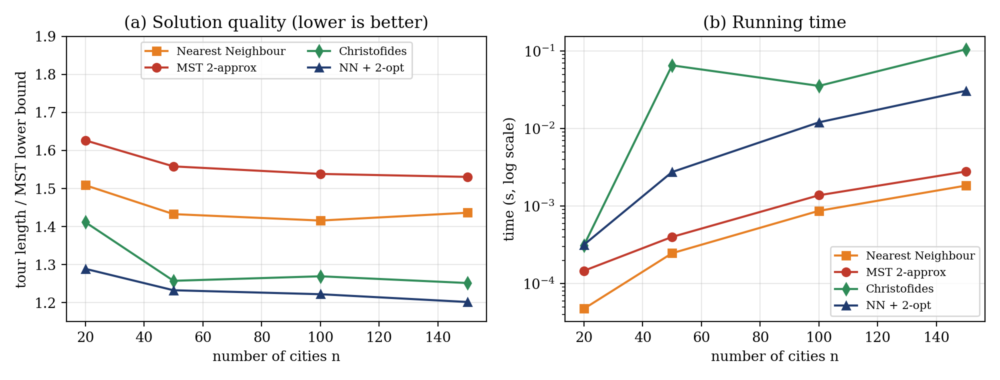
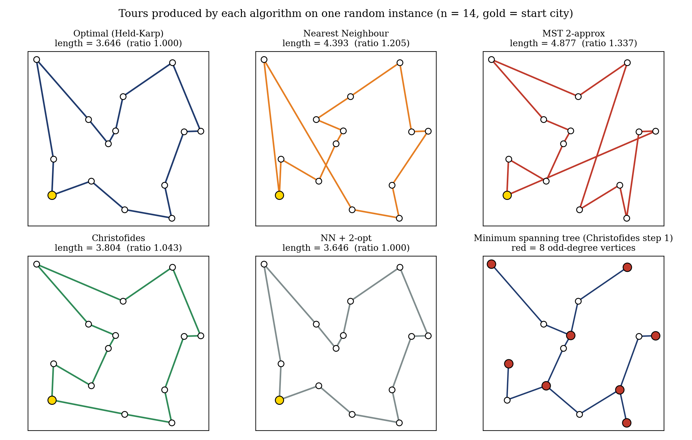

# Metric Traveling Salesperson Problem (TSP): Exact, Approximation, and Heuristic Algorithms

[](https://www.python.org/)
[](https://opensource.org/licenses/MIT)
[](tests/test_tsp.py)

An algorithmic framework comparing exact exponential-time solvers, provable polynomial-time approximation schemes, and local search heuristics for the **Metric Traveling Salesperson Problem ($\Delta$-TSP)** on two-dimensional Euclidean planes.

---

## 1. Problem Formulation

Given a complete undirected weighted graph $G = (V, E)$ where $|V| = n$, with vertices embedded in the metric space $(\mathbb{R}^2, \|\cdot\|_2)$ on the unit square $[0, 1]^2$. The edge weights satisfy the metric axioms:
1. **Non-negativity:** $d(u, v) \ge 0$ with $d(u, v) = 0 \iff u = v$
2. **Symmetry:** $d(u, v) = d(v, u)$
3. **Triangle Inequality:** $d(u, v) \le d(u, w) + d(w, v) \quad \forall u, v, w \in V$

The objective is to find a Hamiltonian cycle $\pi \in S_n$ that minimizes total traversal cost:

$$\min_{\pi \in S_n} \mathcal{L}(\pi) = \sum_{i=1}^{n} d\left(\pi(i), \, \pi((i \bmod n) + 1)\right)$$

---

## 2. Algorithm Taxonomy & Theoretical Bounds



| Algorithm | Method / Paradigm | Time Complexity | Space Complexity | Approximation Ratio ($\alpha = \frac{\text{ALG}}{\text{OPT}}$) | Practical Limit |
|---|---|---|---|---|---|
| **Brute Force** | Exhaustive factorial search | $\mathcal{O}((n-1)!)$ | $\mathcal{O}(n)$ | $1.0$ (Exact) | $n \le 10$ |
| **Held-Karp** | Bellman-Held-Karp subset DP | $\mathcal{O}(n^2 2^n)$ | $\mathcal{O}(n 2^n)$ | $1.0$ (Exact) | $n \le 18$ |
| **Branch & Bound** | Depth-first search with 1-tree LB | $\mathcal{O}((n-1)!)$ | $\mathcal{O}(n)$ | $1.0$ (Exact) | $n \le 13$ |
| **Nearest Neighbour** | Greedy selection | $\mathcal{O}(n^2)$ | $\mathcal{O}(n)$ | $\Theta(\log n)$ | $n \ge 10^4$ |
| **MST Double-Tree** | Spanning tree Eulerian tour shortcut | $\mathcal{O}(n^2)$ | $\mathcal{O}(n)$ | $\le 2.0$ | $n \ge 10^4$ |
| **Christofides** | MST + Min-Weight Perfect Matching | $\mathcal{O}(n^3)$ | $\mathcal{O}(n^2)$ | $\le 1.5$ | $n \le 2 \times 10^3$ |
| **2-Opt (Local Search)** | Edge exchange $(\Delta < 0)$ | $\mathcal{O}(k \cdot n^2)$ | $\mathcal{O}(n)$ | Empirical ($\approx 1.00 - 1.05$) | $n \le 10^3$ |

---

## 3. Algorithmic Implementations

### 3.1 Exact Algorithms (`tsp/exact.py`)
* **Brute Force:** Permutes cities $\{1, \dots, n-1\}$ fixing vertex $0$.
* **Held-Karp DP:** Vectorized state recurrence over bitmask subsets $S \subseteq V \setminus \{0\}$:
  $$\text{dp}[S][j] = \min_{i \in S \setminus \{j\}} \left(\text{dp}[S \setminus \{j\}][i] + d(i, j)\right)$$
* **Branch and Bound:** Explores DFS branches in nearest-neighbor order. Prunes subtrees where:
  $$\text{LB}(P, U) = \text{cost}(P) + \min_{u \in U} d(c, u) + \sum_{u \in U} \min_{w \in (U \cup \{0\}) \setminus \{u\}} d(u, w) \ge \text{Incumbent}$$

### 3.2 Approximation & Heuristics (`tsp/approx.py`)

#### Christofides 1.5-Approximation Pipeline




* **2-Approximation (MST Double-Tree):** Constructs MST $T$, doubles edges $2T$, computes Eulerian walk, and shortens repeated visits via triangle inequality:
  $$\text{cost}(\text{tour}) \le \text{cost}(2T) = 2 \cdot \text{cost}(T) \le 2 \cdot \text{OPT}$$
* **1.5-Approximation (Christofides, 1976):** Since $|O|$ is even and $\text{cost}(M) \le \frac{1}{2}\text{OPT}$:
  $$\text{cost}(\text{tour}) \le \text{cost}(T) + \text{cost}(M) \le \text{OPT} + \frac{1}{2}\text{OPT} = 1.5 \cdot \text{OPT}$$
* **2-Opt Optimization:** Iteratively untangles crossing edges $(i, i+1)$ and $(j, j+1)$ whenever $d(i, j) + d(i+1, j+1) < d(i, i+1) + d(j, j+1)$.

---

## 4. Empirical Evaluation

### 4.1 Exact Runtime & Pruning Efficiency ($n \in [4, 18]$)

| $n$ | Brute Force (s) | Branch & Bound (s) | B&B Nodes Expanded | Held-Karp DP (s) | Search Space $(n-1)!$ |
|---:|:---:|:---:|:---:|:---:|:---:|
| **4** | $9.95 \times 10^{-6}$ | $2.76 \times 10^{-5}$ | 10 | $4.30 \times 10^{-5}$ | 6 |
| **6** | $1.02 \times 10^{-4}$ | $1.37 \times 10^{-4}$ | 69 | $1.74 \times 10^{-4}$ | 120 |
| **8** | $5.71 \times 10^{-3}$ | $1.49 \times 10^{-3}$ | 687 | $9.54 \times 10^{-4}$ | $5.04 \times 10^3$ |
| **10** | 0.5030 | $8.23 \times 10^{-3}$ | 2,630 | $5.04 \times 10^{-3}$ | $3.63 \times 10^5$ |
| **12** | *Time Limit* | 0.1159 | 31,522 | 0.0267 | $3.99 \times 10^7$ |
| **13** | *Time Limit* | 0.4753 | 125,624 | 0.0574 | $4.79 \times 10^8$ |
| **16** | *Time Limit* | *Memory/Time* | — | 0.5584 | $1.31 \times 10^{12}$ |
| **18** | *Time Limit* | *Memory/Time* | — | 2.4989 | $3.56 \times 10^{14}$ |



---

### 4.2 Approximation Ratio Distribution ($n=12$, $N=40$ Instances)

Ratios computed relative to exact optimal tour length from Held-Karp ($\alpha = \frac{\mathcal{L}}{\mathcal{L}^*}$):

| Algorithm | Mean $\mu$ | Median | Worst-case $\max$ | Best-case $\min$ | Theoretical Bound | Verification |
|---|:---:|:---:|:---:|:---:|:---:|:---:|
| **Nearest Neighbour** | 1.112 | 1.101 | 1.366 | 1.000 | $\mathcal{O}(\log n)$ | Valid |
| **MST 2-Approx** | 1.185 | 1.169 | 1.408 | 1.000 | $\le 2.000$ | **Passed ($\le 2.0$)** |
| **Christofides** | 1.056 | 1.045 | 1.139 | 1.000 | $\le 1.500$ | **Passed ($\le 1.5$)** |
| **NN + 2-Opt** | 1.003 | 1.000 | 1.053 | 1.000 | Heuristic | Near-optimal |



---

### 4.3 Large-Scale Scalability ($n \in [20, 150]$ vs. MST Lower Bound)

Since exact computation is intractable for $n \ge 20$, solution quality is evaluated against the MST weight lower bound ($\text{LB}_{\text{MST}} \le \text{OPT}$):

| $n$ | Metric | Nearest Neighbour | MST 2-Approx | Christofides | NN + 2-Opt |
|---:|---|:---:|:---:|:---:|:---:|
| **20** | $\mathcal{L} / \text{LB}_{\text{MST}}$ <br> Execution Time | 1.509 <br> $< 0.1$ ms | 1.627 <br> $0.1$ ms | 1.412 <br> $0.3$ ms | **1.289** <br> $0.3$ ms |
| **50** | $\mathcal{L} / \text{LB}_{\text{MST}}$ <br> Execution Time | 1.433 <br> $0.2$ ms | 1.558 <br> $0.4$ ms | 1.258 <br> $65.4$ ms | **1.233** <br> $2.8$ ms |
| **100** | $\mathcal{L} / \text{LB}_{\text{MST}}$ <br> Execution Time | 1.416 <br> $0.9$ ms | 1.538 <br> $1.4$ ms | 1.269 <br> $35.6$ ms | **1.222** <br> $12.1$ ms |
| **150** | $\mathcal{L} / \text{LB}_{\text{MST}}$ <br> Execution Time | 1.436 <br> $1.8$ ms | 1.531 <br> $2.8$ ms | 1.252 <br> $105.4$ ms | **1.202** <br> $30.7$ ms |



---

### 4.4 Tour Geometry & Visual Comparison

Visual comparison of tour topologies generated on an identical Euclidean instance ($n = 14$):



---

## 5. Repository Structure

```
├── tsp/
│   ├── __init__.py           # Package exports
│   ├── exact.py              # Brute force, Held-Karp DP, Branch & Bound
│   ├── approx.py             # Nearest Neighbour, Prim MST, Double-tree, Christofides, 2-Opt
│   └── utils.py              # Instance generator, Euclidean distance, validation metrics
├── tests/
│   └── test_tsp.py           # 16-case pytest suite (invariance, correctness, guarantees)
├── outputs/
│   ├── exact_runtime.csv     # Raw empirical runtimes & node counts
│   ├── approx_ratio.csv      # Statistical distributions (n=12, N=40)
│   └── figures/              # Generated high-resolution publication plots
├── main.py                   # Single-instance CLI demonstration & comparative report
├── benchmark.py              # Complete experimental suite & figure rendering pipeline
└── requirements.txt          # Minimal dependency specifications
```

---

## 6. Execution & Verification

### 6.1 Installation
```bash
git clone https://github.com/AdityaWagh19/TSP-Solver.git
cd TSP-Solver
pip install -r requirements.txt
```

### 6.2 CLI Demonstration
Execute all solvers on a generated instance of size $n$ with random seed $s$:
```bash
python main.py <n_cities> <random_seed>
# Example:
python main.py 10 7
```

### 6.3 Benchmark Suite & Artifact Reproduction
Executes Experiments 1–3 and regenerates all publication figures and CSV logs into `outputs/`:
```bash
python benchmark.py
```

### 6.4 Unit & Property Testing
Validates tour validity ($\forall v \in V$, degree $= 2$), exact algorithm optimality consensus, approximation ratio bounds, and 2-opt monotonic cost non-increase:
```bash
python -m pytest -v
```

---

## 7. References
1. Bellman, R. (1962). *Dynamic programming treatment of the travelling salesman problem*. Journal of the ACM (JACM), 9(1), 61-63.
2. Held, M., & Karp, R. M. (1962). *A dynamic programming approach to sequencing problems*. Journal of the Society for Industrial and Applied Mathematics, 10(1), 196-210.
3. Christofides, N. (1976). *Worst-case analysis of a new heuristic for the travelling salesman problem*. Technical Report 388, Graduate School of Industrial Administration, Carnegie Mellon University.
4. Croes, G. A. (1958). *A method for solving traveling-salesman problems*. Operations Research, 6(6), 791-812.
